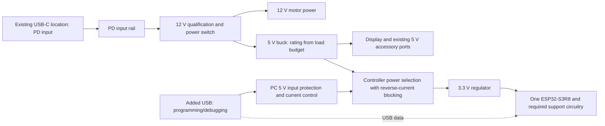

# V3 power and USB architecture proposal

Updated: 2026-09-12. Status: separate power/service connections agreed;
power-path implementation, service-connector population, and components remain
proposed. Confirmed needs are REQ-PWR-001/002 and REQ-USB-001/002/003 in
[REQUIREMENTS.md](REQUIREMENTS.md).

The user authorizes reducing the inherited 5 V converter to match real loads.
Motors require 12 V from USB-PD; 5 V from the debug connection must not power
them. The master project's compatible 12 V PD PSU requirement is retained;
15/20 V-only sources need not be supported. V3's required PSU current/power is
still calculated from its own load budget. Programming/debugging must coexist
with the main PD supply. V3 contains exactly one MCU, the ESP32-S3R8; the
autonomous PD controller is a dedicated peripheral function.

The user now requests Fly TMC2209 StepStick reference practice with passive
heatsinks for room-temperature use, potentially inside a case, and excludes
a separate thermal-design exercise. The 800 mA RMS default remains; the higher
software range is not a qualified continuous-current board rating. This does
not remove the electrical load budget needed to choose the power components.

**Agreed direction and recommendation.** Retain the archived v2.1 connector
location for dedicated PD power and provide separate programming/debug access.
Consider a vertical USB service connector, populated for development and
optionally omitted in production, with programming/recovery contact pads. Keep the PC's
power path confined to controller power, with reverse-current blocking between
sources. Qualify the PD input as an acceptable 12 V supply before physically
connecting motor power. Service connector placement/population, pad layout, and
controller operation from PC USB alone are still proposals.

This is a functional diagram, not a complete protection schematic. The motor
switch must cover the relevant voltage/current conditions and residual rail
discharge. The controller power selector is on regulated low-voltage inputs;
it must not receive the raw PD voltage. Grounds remain common. Check signal
paths into unpowered displays, buffers, and drivers so I/O cannot create an
unintended supply path.

The PD negotiation and voltage qualification must start independently of the
ESP32. Qualifying the input before feeding both the motor rail and the main
5 V buck also keeps the two servos off during unsuccessful negotiation. The
PC branch feeds neither the 12 V stepper rail nor the 5 V servo/accessory rail.
Thus controller-only service cannot energize either type of actuator.

**What the V2 files establish.** These observations have high confidence as
netlist facts, with no claim of measured electrical behaviour. They come from
the native KiCad export recorded in
[research/design-inventory.json](research/design-inventory.json).

| Evidence | Consequence for V3 |
| --- | --- |
| IC1 is TPS5450DDA. Its input and both StepStick VM pins share the USB input rail. | Motor current bypasses the 5 V buck. Size the buck from its own loads. |
| The +5 V net supplies the Pico VSYS input, EXP1/EXP2, J11/J12/J13 accessory power, and U5-U8 buffers. | External accessories and the chosen display must be included in downsizing. |
| J8's value text says USB2.0_14P, but its symbol is USB_C_Receptacle_PowerOnly_6P. Native PCB inspection also finds only A5/A9/A12/B5/B9/B12 electrical pads plus four shield pads; no D+/D- pads. | The placed V2 footprint is power-only despite its library name. A data-capable service connection needs an appropriate USB 2.0 Type-C footprint. |
| CH224K CC1/CC2 connect to J8. Its DP and DM pins connect to each other, away from the receptacle. | Do not copy that separate DP/DM connection onto ESP32 USB data wiring. |

TI specifies the TPS5450 as a 5 A converter with a 5.5 V minimum input. Thus a
normal 5 V PC USB source is below its rated input range; controller-only USB
power needs a suitable separate path. This does not demonstrate that the
assembled V2 board can continuously deliver 5 A.
[TPS5450 product specification](https://www.ti.com/product/TPS5450).

USB-PD and USB data can coexist on a suitable connector: Type-C PD communication
uses CC, while USB 2.0 uses D+/D-. The proposed second port allows a charger and
PC to be attached independently and preserves the existing power connection.
A shared single port would require a different connection/power arrangement for
simultaneous charger power and PC debugging; it is not ruled out by the PD
protocol itself.
[TI USB Type-C/PD primer](https://www.ti.com/lit/wp/slyy109b/slyy109b.pdf).

**PD controller and connector choice.** CH224K is one PD sink-controller
option, not a required brand or part number. Autonomous controllers can handle
negotiation independently of the application MCU; STUSB4500 is an example with
stored power profiles. This independence is recommended for V3 startup. Final
selection still needs 12 V request/fallback behaviour, power-path capability,
and supplier verification.
[STUSB4500 manufacturer description](https://www.st.com/en/interfaces-and-transceivers/stusb4500.html).

The other established implementation is MCU-managed PD with a PD physical
interface. An ordinary USB data peripheral and passive Type-C sink resistors
alone do not implement the PD protocol. Ordinary USB-A-to-C cables cannot carry
USB-C PD's end-to-end CC negotiation. Also, 12 V is not a mandatory fixed voltage
on every PD charger; qualify a source that explicitly provides it.
[TI USB Type-C/PD primer](https://www.ti.com/lit/wp/slyy109b/slyy109b.pdf).

USB 2.0 Type-C supports data and can support PD without USB 3.x/USB4 wiring.
Thus V3 does not need a full SuperSpeed connector implementation. A suitable
service receptacle accepts an A-to-C USB data cable for 5 V service; this does
not make that cable a 12 V PD input. Retaining J8 for dedicated power does not
require adding its missing data contacts.
[USB-IF connector and cable guidance](https://www.usb.org/sites/default/files/usb_type-c_language_product_and_packaging_guidelines_20230320.pdf).

**Service assembly variants.** The proposed development build populates the
service USB connector. A production build may omit it while retaining contact
pads for a programming fixture. Preserve access to USB data, a ground reference,
the defined protected service supply, and boot/reset recovery; the exact pad
set and geometry must match Mellow's fixture. Account for both connector and
fixture wiring in the USB layout. Native ESP32-S3 USB Serial/JTAG supports
flashing and debugging without a separate USB-UART bridge. Boot/reset access
allows recovery if application firmware disables USB. OTA support must be
implemented and demonstrated; it is not a substitute for initial loading or
recovery when the application cannot run.
[Espressif USB Serial/JTAG documentation](https://docs.espressif.com/projects/esp-idf/en/stable/esp32s3/api-guides/usb-serial-jtag-console.html).

**Proposed operating cases.** Controller power from PC USB alone is included
below as the recommended service behaviour, pending a decision under OQ-013.

| Connections | Controller | Motors | Display / powered accessories |
| --- | --- | --- | --- |
| Valid 12 V PD only | Main supply | Power available; enable/reset behaviour still enforced | Main supply |
| Debug USB only | PC supply within the port's permitted current | Power disconnected | Off in this proposal |
| Valid 12 V PD and debug USB | Main supply preferred; PC data active | Supplied only by PD | Main supply |
| PD still at 5 V or invalid/failed negotiation | PC service source if connected; otherwise off in this proposal | Power disconnected | Off |
| PD removed while debug remains | Return to controller-only service state | Disconnect motor supply and discharge residual energy as specified | Off |

Use hardware input-voltage qualification and power switching for the motor
restriction. Merely checking the requested PD voltage or relying on firmware
ENABLE states is insufficient to demonstrate that the motor rail cannot receive
the wrong source. The acceptable 12 V window and sequencing remain TBD. The
input protection and switching must tolerate the defined PD negotiation and
fault envelope. The converter must tolerate the voltage it can receive under
the specified operating and fault conditions.

The ESP32-S3's native USB Serial/JTAG supports flashing, a serial console, and
JTAG debugging through GPIO19/20. Keep boot/reset recovery access. Resolve USB
VBUS detection/attach behaviour, allowed PC current before and after enumeration,
and suspend behaviour during implementation. Controller-only service may need
to restrict high-current features such as radio activity to stay within the
available USB power budget.
[Espressif USB Serial/JTAG documentation](https://docs.espressif.com/projects/esp-idf/en/stable/esp32s3/api-guides/usb-serial-jtag-console.html).

Power selection must prevent either supply from feeding the other, including
when one input is absent. A priority power mux is one possible implementation;
TI documents devices with reverse-current blocking and controlled switching.
Part choice, input limits, current limiting, and fault response must be reviewed
separately. No mux is selected here.
[TI power-mux overview](https://www.ti.com/product-category/power-management/power-protection-switches-controllers/power-muxes/overview.html).

**5 V load budget to complete before part selection.**

| Load group | Basis needed | Current status |
| --- | --- | --- |
| MCU, flash, and required 3.3 V support | Peak rail demand, regulator efficiency, operating modes | TBD; do not use typical MCU current as the design ceiling |
| Mini12864 | Exact model, its three lighting LEDs at required brightness, startup demand | TBD; these LEDs are additional to the external chain |
| Required first-prototype QSPI display | Selected 3.5-4 inch panel/backlight and any touch supply rails, startup demand | Mellow/Fly AliExpress primary target; no encoder/buttons in this mode. Select the actual panel and control method before fixing the connector and power budget |
| Two MG90S servos | Peak/current waveforms for the sourcing-guide baseline under the supported load | Model/source settled: full-metal 180-degree recommendation, AliExpress item 1005004550692203. Budget overlapping demand; physical measurement belongs to Mellow |
| External NeoPixels | Four board-powered LEDs; typical installation uses two | Reference product is RGBW; approximately 0.30 A for four at full output. Longer chains externally powered |
| Buffers and other small loads | Datasheet maxima and output loading | Connections identified; current values TBD |
| Motor winding power | Separate 12 V PD budget; 800 mA RMS default, software adjustment up to 1.2-1.5 A RMS per channel | Use Fly reference practices and passive heatsinks for room-temperature operation; no separate thermal design or continuous upper-current rating. Winding current is not USB input current. Excluded from the 5 V buck budget; driver logic remains in its appropriate logic-rail budget |

For each supported display/operating mode, add direct 5 V loads to the input
power required by any downstream 3.3 V regulator. With a buck, the latter is
approximately `3.3 * I_3V3 / (5 * efficiency)` amperes plus applicable overhead;
with an LDO it is approximately `I_3V3` plus quiescent current. Select for the
worst supported mode, transient behaviour, and thermal margin. The two mutually
exclusive displays do not need to run together.

Espressif recommends a 3.3 V supply capable of at least 500 mA for the MCU supply
design. That is a regulator capability recommendation, not a measured current
or a complete board budget. Add other rail loads and evaluate conversion losses.
[Espressif power-supply guidance](https://docs.espressif.com/projects/esp-hardware-design-guidelines/en/latest/esp32s3/schematic-checklist.html).

No replacement 5 V converter or 1 A / 2 A / other rating is selected yet.
Reducing the rating is authorized once the load envelope supports it. New
power-status, VBUS-sense, or control GPIOs would also reduce the previous
two-spare-GPIO planning estimate unless handled without extra MCU pins. A
separate replacement for the Pico's Wi-Fi indicator is another unallocated pin
if that indicator is retained separately.

The referenced accessory uses Adafruit 4776 RGBW pixels, whose technical details
give approximately 75 mA maximum per pixel; four therefore provisionally account
for 0.30 A. The MG90S manufacturer's page does not specify a stall-current
limit. DEC-019 establishes the sourcing-guide MG90S as the selected baseline;
the remaining current evidence is an engineering check, not a new owner-selection
question. The firmware's
two-channel update and the full accessory evidence are in
[USE_CASE_RESEARCH.md](USE_CASE_RESEARCH.md).
[Adafruit 4776](https://www.adafruit.com/product/4776),
[TowerPro MG90S](https://towerpro.com.tw/product/mg90s-3/).

With longer externally powered LED chains, specify a common signal reference
and a wiring method that leaves the board's 5 V feed disconnected from the
external supply. Retain the data capability independently of the four-pixel
board-power limit.

**Acceptance evidence and remaining scope.** Check all power combinations,
both cable orientations, reset/recovery, hot plugging, failed negotiation,
debug-only motor isolation, cross-source backfeed, and load/thermal behaviour
on prototypes. Record the declared PC service-mode current and supported PD
source range. These checks are proposed; none has been performed on V3 hardware.
Under DEC-019, Mellow/owner execute physical testing after the assistant hands
off the schematic, PCB layout and first preliminary BOM. This document supplies
design and acceptance guidance; it does not assign physical bring-up to the assistant.

Trust summary: net connectivity and regulator limits are supported by native
files and manufacturer documentation. The recommended architecture is an
engineering proposal. Current totals, protection implementation, switching
behaviour, and final GPIO use remain unverified pending component selection,
schematic work, and hardware tests.
